# Airbnb Sydney ELT Pipeline

An end-to-end ELT data pipeline that loads 12 months of Sydney Airbnb listings (May 2020 – April 2021) and the ABS 2016 Census into a **Bronze → Silver → Gold** medallion warehouse on Google Cloud. **Apache Airflow (Cloud Composer)** ingests the raw files into **Cloud SQL for PostgreSQL**, **dbt Cloud** cleans and models them into a star schema with **SCD Type 2** history, and SQL datamart views plus ad-hoc analysis answer business questions about revenue, host behaviour and neighbourhood demographics.

## Table of Contents
- [Project Overview](#project-overview)
- [Problem Statement](#-problem-statement)
- [Dataset](#-dataset)
- [Key Metrics](#-key-metrics)
- [Solution Architecture](#️-solution-architecture)
- [Tools and Technologies](#️-tools-and-technologies)
- [Part 1: Airflow Ingestion (Bronze)](#-part-1-airflow-ingestion-bronze)
- [Part 2: dbt Data Warehouse (Silver & Gold)](#-part-2-dbt-data-warehouse-silver--gold)
- [Part 3: Loading the Remaining Months](#-part-3-loading-the-remaining-months)
- [Part 4: Ad-hoc Analysis](#-part-4-ad-hoc-analysis)
- [Issues Encountered and Resolutions](#️-issues-encountered-and-resolutions)
- [Recommendations](#-recommendations)
- [Repository Structure](#-repository-structure)
- [How to Run](#️-how-to-run)
- [Handover Notes](#-handover-notes)
- [Conclusion](#conclusion)
- [Contact](#contact)

## Project Overview
This project builds a production-style ELT pipeline for **94693 Big Data Engineering – Assignment 3**. A single parameterised Airflow DAG moves raw CSV files from a Google Cloud Storage bucket into a Postgres Bronze schema without changing them. dbt then does every transformation: typing, cleaning, key standardisation, SCD2 snapshots, a Gold star schema and three KPI datamart views.

Loading and transformation are kept separate on purpose. Airflow only moves files; all business logic lives in dbt, so it is version-controlled, testable, re-runnable and visible as a lineage graph. All services run in `australia-southeast1` so data and compute stay in-region.

## 🚩 Problem Statement
Raw Airbnb scrapes and Census tables cannot be joined or compared directly: codes, name casing and date formats differ between files, and listing attributes change from month to month. The pipeline needed to:

- 📥 Load 16 raw CSV files reliably and repeatably, one month at a time
- 🧹 Fix join-breaking mismatches between listings, LGA mappings and Census data
- 🕰️ Keep a monthly history of how hosts, properties and neighbourhoods changed (SCD Type 2)
- ⭐ Model a star schema that supports fast, point-in-time-correct analytics
- 📊 Publish monthly KPIs by listing neighbourhood, property type and host LGA
- 🔍 Answer five business questions on revenue, demographics, listing types and host economics

## 📂 Dataset
| Source | Rows | Description |
|---|---|---|
| **Inside Airbnb – Sydney** (12 monthly files, `05_2020.csv` – `04_2021.csv`) | 31,391 – 37,562 per month; **412,122 total** | One row per listing per monthly scrape; identical 22-column schema |
| **ABS 2016 Census G01** (`2016Census_G01_NSW_LGA.csv`) | 132 | Person characteristics by sex, 11 age bands, birthplace, language and education (109 columns) |
| **ABS 2016 Census G02** (`2016Census_G02_NSW_LGA.csv`) | 132 | Medians and averages: age, mortgage, rent, income, household size |
| **NSW LGA Code** (`NSW_LGA_CODE.csv`) | 129 | Numeric LGA code → title-case LGA name |
| **NSW LGA Suburb** (`NSW_LGA_SUBURB.csv`) | 4,470 | Upper-case suburb → LGA name |

Join path: `listing_neighbourhood → LGA name → LGA code → Census`, and `host_neighbourhood → suburb → LGA name`.

## 📊 Key Metrics
- **Listing rows loaded:** 412,122 across 12 months
- **Distinct listings / hosts:** 45,613 listings · 31,001 hosts
- **Highest-revenue LGA:** Mosman, **A$9,327** per active listing per month
- **Lowest-revenue LGA:** Fairfield, **A$1,298** per active listing per month (about 7.2× lower)
- **Median age vs revenue:** Pearson r = 0.655, Spearman ρ = 0.576 (n = 29 LGAs)
- **Household income vs revenue:** Pearson r = 0.728, the stronger signal
- **Multi-listing hosts in a single LGA:** 76.7% (3,910 of 5,095)
- **Single-listing hosts covering the median mortgage:** 43.5% (11,257 of 25,906)
- **Best mortgage-cover LGA:** Northern Beaches, 56.5%
- **SCD2 history captured:** 304,937 host versions for 31,001 hosts; 1,576 hosts changed superhost status
- **dbt job:** 38 models, snapshots and tests, about 49 s per monthly run

## 🏗️ Solution Architecture

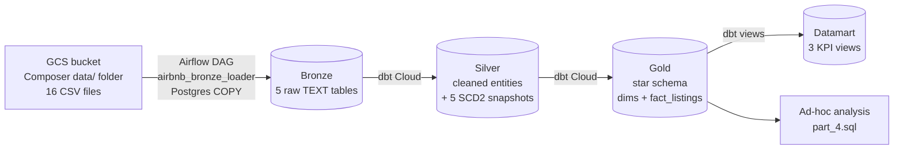

| Layer | Contents | Materialisation | Why |
|---|---|---|---|
| **Bronze** | 5 raw tables, all `TEXT`, plus `source_file` and `loaded_at` | Tables (Airflow) | Never rejects a source row; full lineage |
| **Silver** | Typed, cleaned entities; 5 SCD2 snapshots | Tables + snapshots | One place for cleaning rules; history preserved |
| **Gold** | Star schema: SCD2 dimensions, 2 Census reference tables, `fact_listings` | Tables | Fast star-schema joins for BI |
| **Datamart** | 3 KPI views | Views | Always reflect the latest Gold; no stale copies |

## 🛠️ Tools and Technologies
- **Orchestration:** Apache Airflow 2 on Google Cloud Composer
- **Storage:** Google Cloud Storage (raw files)
- **Warehouse:** Google Cloud SQL for PostgreSQL
- **Transformation:** dbt Cloud (dbt Core v1.9 release track)
- **Languages:** Python 🐍 (pandas, psycopg2) and SQL
- **SQL client:** DBeaver
- **Profiling:** Python / Jupyter
- **Version control:** Git & GitHub

## 📥 Part 1: Airflow Ingestion (Bronze)

`part_1.sql` creates the `bronze` schema and five raw tables. Every column is `TEXT`, so a malformed value can never fail a load; all typing happens in dbt where rules are tested and versioned. Column names are the lower-cased CSV headers, so the DAG can `COPY` each file straight in without a column mapping.

<p align="center">
  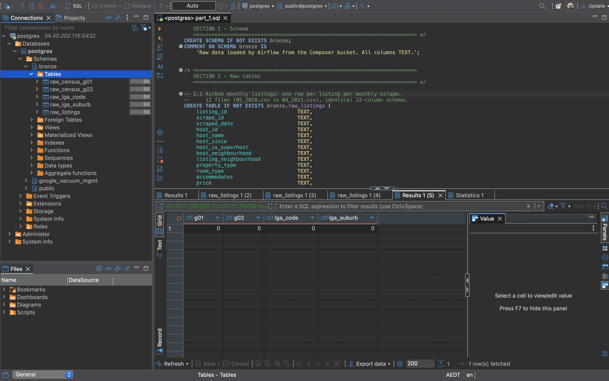
</p>

<p align="center"><em>Figure 4.1: Bronze schema and the five raw tables created in Cloud SQL, viewed in DBeaver</em></p>

The DAG `airbnb_bronze_loader` has five tasks:

```python
[load_lga_code, load_lga_suburb, load_census_g01, load_census_g02] >> load_listings
```

**Design choices**
- **One DAG for Parts 1 and 3:** `month_file` is an Airflow `Param` shown as a drop-down on the *Trigger DAG* form, so the same DAG loads any month unchanged.
- **Manual schedule** (`schedule_interval=None`): the dbt job must run between months so snapshots capture monthly history.
- **Idempotent reference loads:** each reference task skips if its Bronze table already has rows.
- **Safe re-runs:** `load_listings` deletes rows for the same `source_file` and reloads them in one transaction, so re-triggering a month never duplicates data.
- **Bulk `COPY ... FROM STDIN`:** much faster than row-by-row `INSERT`s.
- **Reporting-month tag:** every listing row carries `source_file`, because some scrape dates fall outside their file's month.
- **Fail fast, then retry:** 30 s connect timeout, TCP keepalives, 5-minute statement timeout, 60 s lock timeout, 10-minute task timeout and 2 automatic retries.
- **One connection at a time** (`max_active_tasks=1`, `max_active_runs=1`) so the small Composer environment never opens several slow connections at once.

<p align="center">
  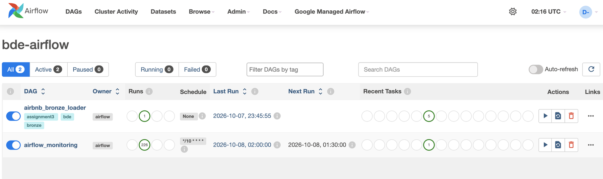
</p>

<p align="center"><em>Figure 4.2: <code>airbnb_bronze_loader</code> deployed on Cloud Composer with Schedule: None (<code>schedule_interval=None</code>)</em></p>

<p align="center">
  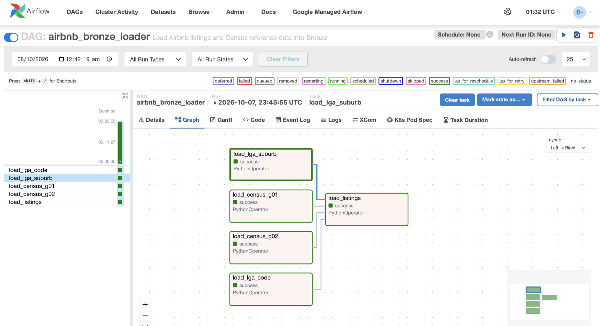
</p>

<p align="center"><em>Figure 4.3: Successful Part 1 run (<code>month_file = 05_2020.csv</code>): the four reference loads, then <code>load_listings</code></em></p>

**Bronze control totals after the May 2020 run**

| Table | Rows |
|---|---|
| `bronze.raw_listings` | 37,562 |
| `bronze.raw_census_g01` | 132 |
| `bronze.raw_census_g02` | 132 |
| `bronze.raw_lga_code` | 129 |
| `bronze.raw_lga_suburb` | 4,470 |

<p align="center">
  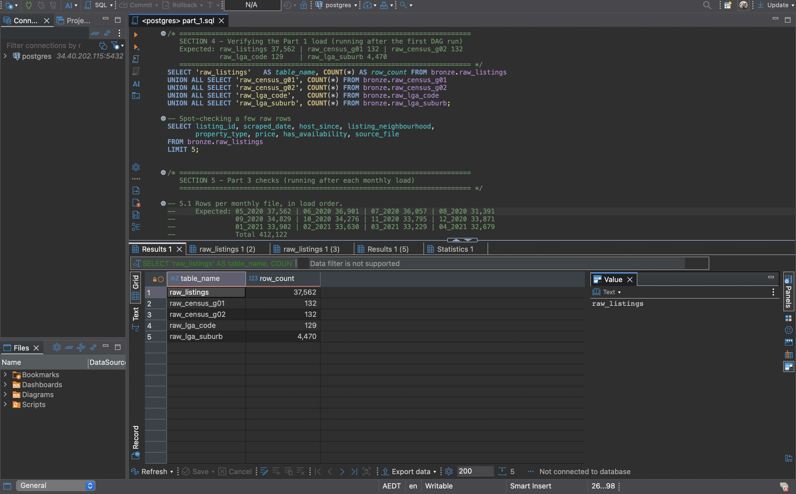
</p>

<p align="center"><em>Figure 4.4: Bronze row counts after the Part 1 run match the source files exactly</em></p>

## ⭐ Part 2: dbt Data Warehouse (Silver & Gold)

### 🧹 Silver: cleaning and decomposition
Each rule below fixes a problem found while profiling the raw files.

| Finding | Evidence | Fix in Silver |
|---|---|---|
| Code format mismatch | Census `LGA10050` vs mapping `10050` | Strip the `LGA` prefix, cast to integer |
| Name case mismatch | `Northern Beaches` vs `NORTHERN BEACHES` | `UPPER(TRIM())` on every LGA and suburb name |
| Mixed date formats | `scraped_date` ISO; `host_since` D/M/YYYY without leading zeros | `scraped_date::date`; `to_date(host_since, 'DD/MM/YYYY')` |
| Scrape dates outside file month | `07_2020.csv` has dates up to 2020-09-05 | Derive `month_year` from `source_file` |
| Missing host data | `host_neighbourhood` null in 36.9% of rows | `UNKNOWN` bucket |
| Price outliers | 12 rows at A$0; max A$28,613 vs median A$120 | Kept; medians reported alongside averages |
| Blank values | `NaN` and empty strings | Converted to `NULL` |

Listings are then split into host, property, listing neighbourhood, LGA and suburb entities, each carrying `month_year`.

### 🕰️ Snapshots (SCD Type 2)
Five timestamp-strategy snapshots (host, property, listing neighbourhood, LGA, suburb) use `month_year` as `updated_at`, giving exactly one version per entity per monthly load. `DISTINCT ON (key)` guarantees one row per key per run. LGA and suburb mappings have no source timestamp, so they are stamped as effective from `1900-01-01`.

```sql

{{ config(target_schema='silver', unique_key='host_id',
          strategy='timestamp', updated_at='updated_at') }}
SELECT DISTINCT ON (host_id) host_id, host_name, host_since,
       host_is_superhost, host_neighbourhood,
       month_year::timestamp AS updated_at
FROM {{ ref('silver_host') }}
ORDER BY host_id, month_year DESC

```

### 🌟 Gold: star schema
- Dimensions expose `valid_from` / `valid_to`. The earliest version of each key is back-dated to `1900-01-01` and an open-ended `valid_to` becomes `9999-12-31`, so every fact row finds a matching version.
- `fact_listings` holds one row per listing per month, with keys and measures only.
- `dim_census_g01` and `dim_census_g02` are Census reference tables keyed on `lga_code`.

<p align="center">
  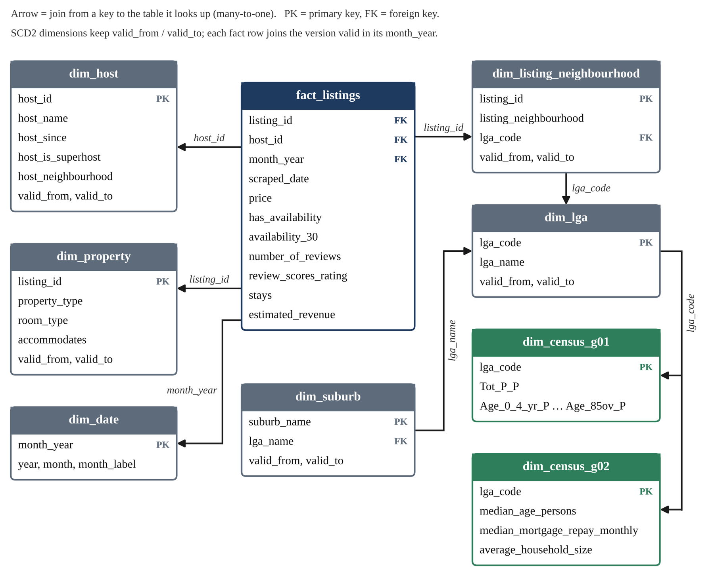
</p>

<p align="center"><em>Figure 5.1: Gold star schema</em></p>

<p align="center">
  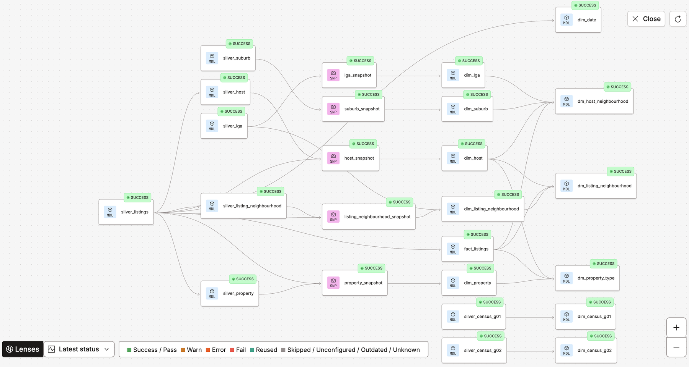
</p>

<p align="center"><em>Figure 5.2: dbt Cloud lineage after the first job run: Silver models feed the five snapshots, which feed the Gold dimensions, the fact table and the three datamart views</em></p>

Every downstream join is **point-in-time correct**:

```sql
JOIN gold.dim_listing_neighbourhood n
  ON  f.listing_id = n.listing_id
  AND f.month_year >= n.valid_from
  AND f.month_year <  n.valid_to
```

### 📊 Datamart views

| View | Grain | Metrics |
|---|---|---|
| `dm_listing_neighbourhood` | listing_neighbourhood × month | Active listing rate; min/max/median/avg price; distinct hosts; superhost rate; avg rating; % change active/inactive; total stays; avg revenue per active listing |
| `dm_property_type` | property_type × room_type × accommodates × month | Same metrics as above |
| `dm_host_neighbourhood` | host_neighbourhood_lga × month | Distinct hosts; estimated revenue; revenue per distinct host |

**Metric definitions**
- **Active listing:** `has_availability = 't'`
- **Stays:** `30 - availability_30` (active listings only)
- **Estimated revenue:** `stays × price`
- Month-on-month changes use `LAG()` with `NULLIF` to guard against division by zero; medians use `PERCENTILE_CONT(0.5)`.

<p align="center">
  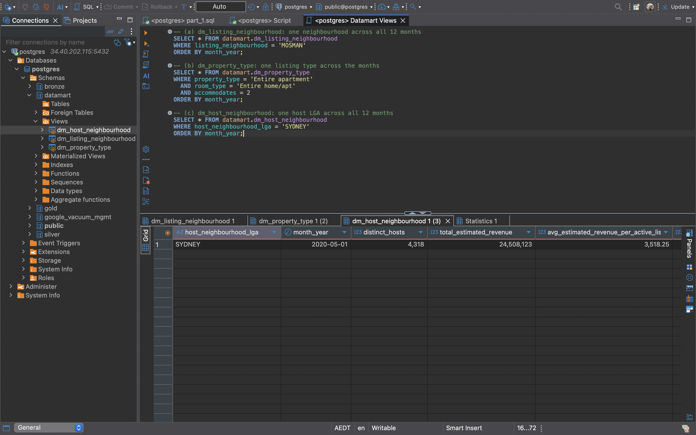
</p>

<p align="center"><em>Figure 5.3: Output of the three datamart views</em></p>

<p align="center">
  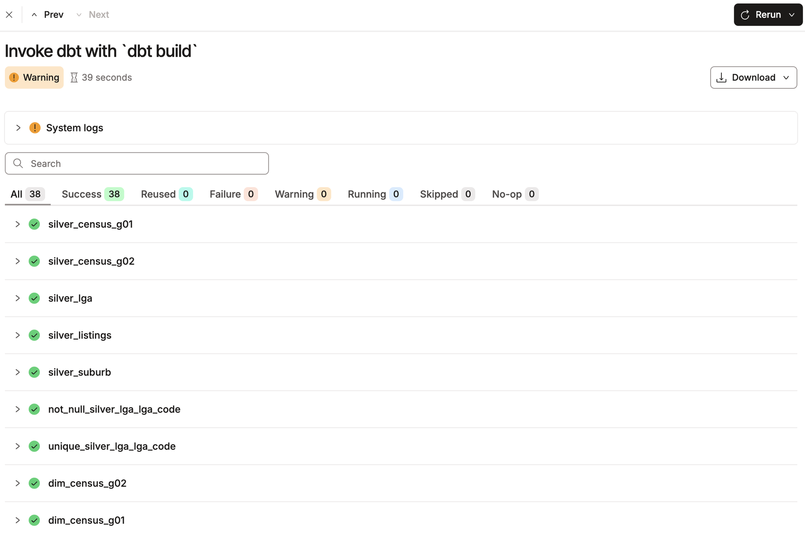
</p>

<p align="center"><em>Figure 5.4: First run of the dbt Cloud job <code>monthly_build</code> after the May 2020 load: all 38 models, snapshots and tests succeeded</em></p>

After the first run, all four medallion layers are in Cloud SQL: Bronze (5 raw tables), Silver (8 cleaned tables and 5 snapshots), Gold (8 dimensions including the two Census references, plus `fact_listings`) and Datamart (3 views).

<p align="center">
  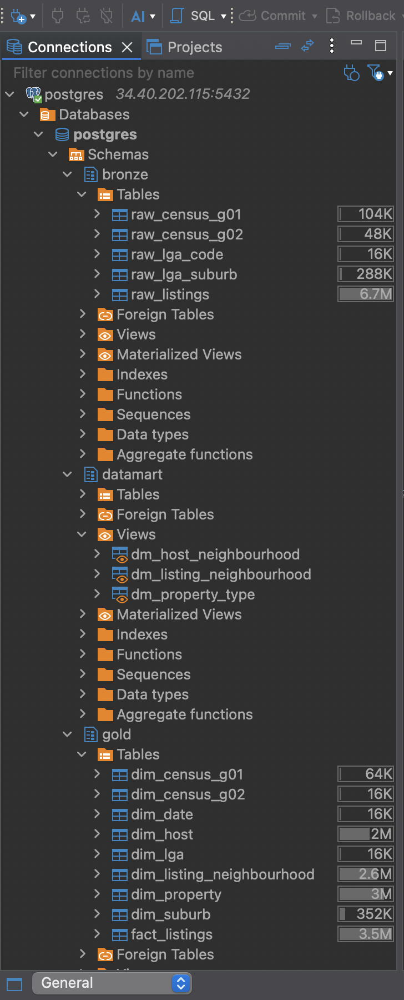
</p>

<p align="center"><em>Figure 5.5: Warehouse layers in Cloud SQL after the first dbt run: Bronze, Silver (with snapshots), Gold star schema and the three datamart views</em></p>

## 🔁 Part 3: Loading the Remaining Months
The remaining 11 months were loaded **strictly in chronological order**: trigger the DAG for one month, check the Bronze count, run the dbt Cloud job (`dbt build`), then move on to the next month.

Order matters because a timestamp snapshot only records a change between consecutive loads. Loading every month before snapshotting would squash a year of history into a single version per entity.

| Month | Rows | Month | Rows |
|---|---|---|---|
| 05_2020 | 37,562 | 11_2020 | 33,795 |
| 06_2020 | 36,901 | 12_2020 | 33,871 |
| 07_2020 | 36,057 | 01_2021 | 33,902 |
| 08_2020 | 31,391 | 02_2021 | 33,630 |
| 09_2020 | 34,829 | 03_2021 | 33,229 |
| 10_2020 | 34,276 | 04_2021 | 32,679 |
| | | **Total** | **412,122** |

<p align="center">
  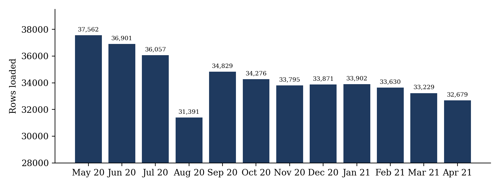
</p>

<p align="center"><em>Figure 6.1: Rows loaded per month (412,122 total)</em></p>

August 2020's low point coincides with Sydney's second COVID-19 wave; volumes never returned to May 2020 levels by April 2021.

The `loaded_at` timestamps confirm that every file reached Bronze exactly once and in chronological order, with a `dbt build` between each load.

<p align="center">
  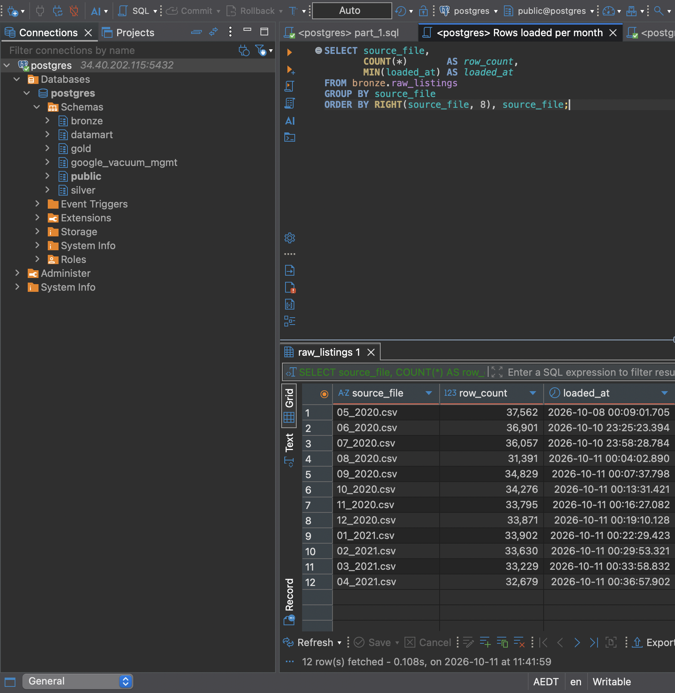
</p>

<p align="center"><em>Figure 6.2: Bronze row counts per source file after all 12 loads; <code>loaded_at</code> shows the months were loaded strictly in order</em></p>

<p align="center">
  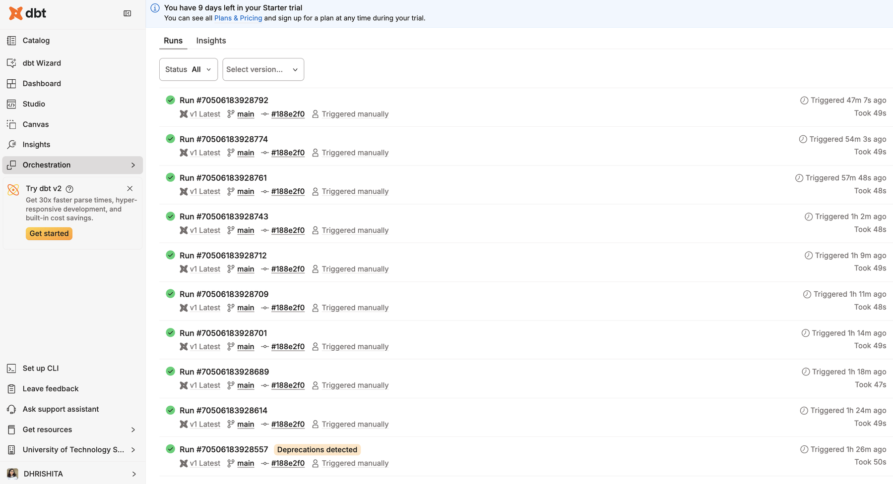
</p>

<p align="center"><em>Figure 6.3: dbt Cloud run history for <code>monthly_build</code>: one manual run after each monthly load, all successful (about 49 s each; most recent 10 runs shown)</em></p>

## 🔍 Part 4: Ad-hoc Analysis
All queries in `part_4.sql` run against the Gold layer over the full 12 months. *Revenue per active listing* is a monthly figure: the average of `stays × price` over active listing-months.

**(a) Demographics of top 3 vs bottom 3 LGAs by revenue**

<p align="center">
  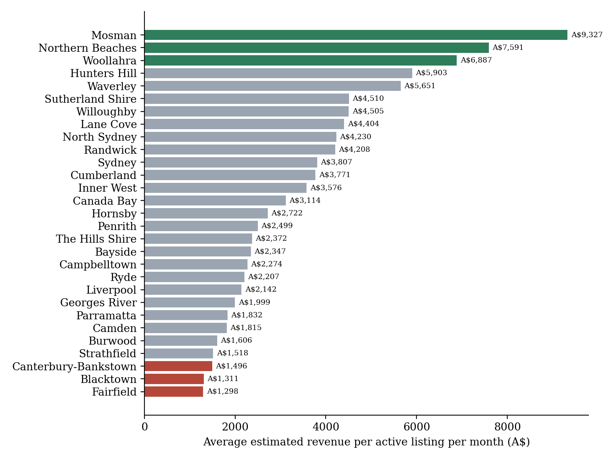
</p>

<p align="center"><em>Figure 7.1: Average revenue per active listing by LGA (top 3 green, bottom 3 red)</em></p>

<p align="center">
  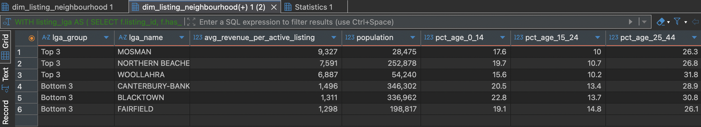
</p>

<p align="center"><em>Figure 7.2: Results table of Top 3 vs Bottom 3 LGAs</em></p>

- 👴 **Older:** median age 39–42 vs 33–36; 16.8–19.1% aged 65+ vs 10.3–13.9%
- 🏠 **Smaller households:** 2.3–2.7 people vs 3.0–3.3, leaving more spare rooms and rentable property
- 💰 **Wealthier:** median household income A$2,178–2,687/week vs A$1,222–1,711; all three top LGAs are coastal or harbourside

**(b) Median age vs revenue**

<p align="center">
  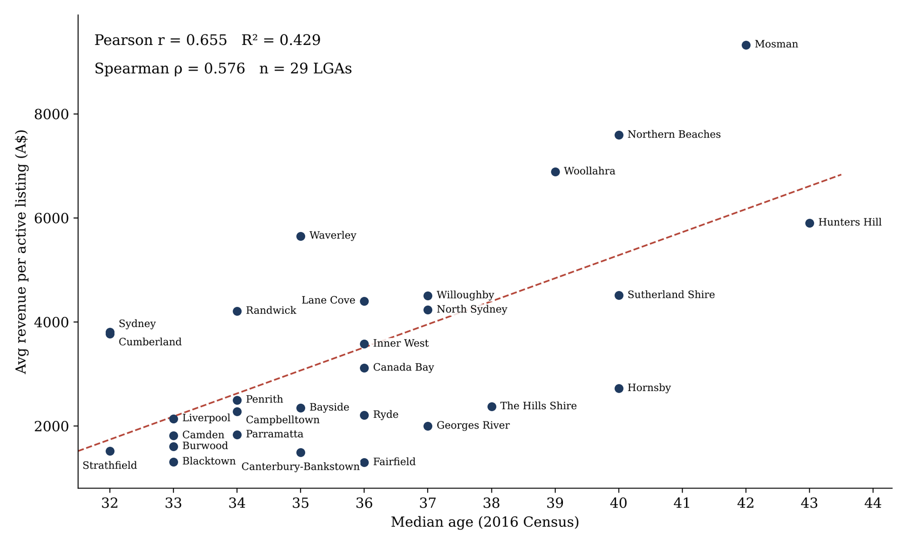
</p>

<p align="center"><em>Figure 7.3: Scatter plot of median age vs revenue</em></p>

<p align="center">
  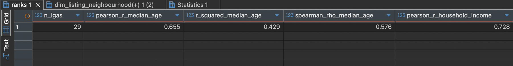
</p>

<p align="center"><em>Figure 7.4: Results table from DBeaver</em></p>

<p align="center">
  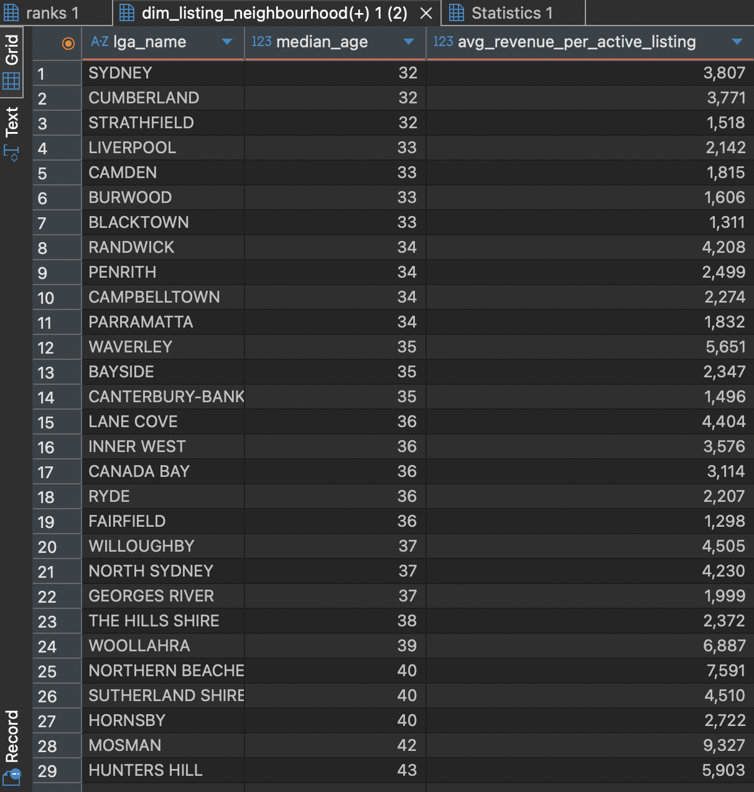
</p>

<p align="center"><em>Figure 7.5: Median age vs revenue per active listing across 29 LGAs</em></p>

- Moderate positive correlation: r = 0.655, R² = 0.429, Spearman ρ = 0.576, so the result is not driven by Mosman alone.
- Household income correlates more strongly (r = 0.728), so median age is unlikely to be causal. With only 29 LGAs, the estimate is sensitive to outliers.

**(c) Best listing type for the top 5 neighbourhoods**
- The top 5 are Mosman, Northern Beaches, Woollahra, Hunters Hill and Waverley.

<p align="center">
  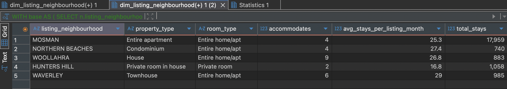
</p>

<p align="center"><em>Figure 7.6: Best listing configuration per top 5 neighbourhood</em></p>

- An **entire apartment for 2–4 guests** is the most-booked format in all five, at 24–28 stays per month.
- Larger entire homes (6–9 guests) reach slightly higher occupancy, but only across 10–12 listings each, so they are a niche rather than a scalable strategy.

**(d) Multi-listing host concentration**

<p align="center">
  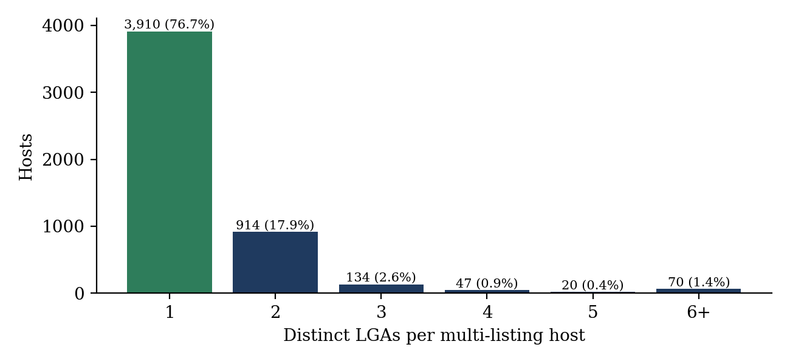
</p>

<p align="center"><em>Figure 7.7: Multi-listing hosts by number of distinct LGAs</em></p>

- 76.7% of multi-listing hosts operate in a single LGA and a further 17.9% in two.

<p align="center">
  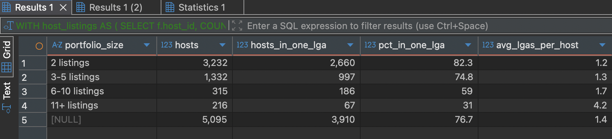
</p>

<p align="center"><em>Figure 7.8: Single-LGA share by portfolio size</em></p>

- Spread grows with portfolio size: hosts with 11+ listings average 4.2 LGAs, behaving like professional property managers.

**(e) Single-listing hosts vs median mortgage**

<p align="center">
  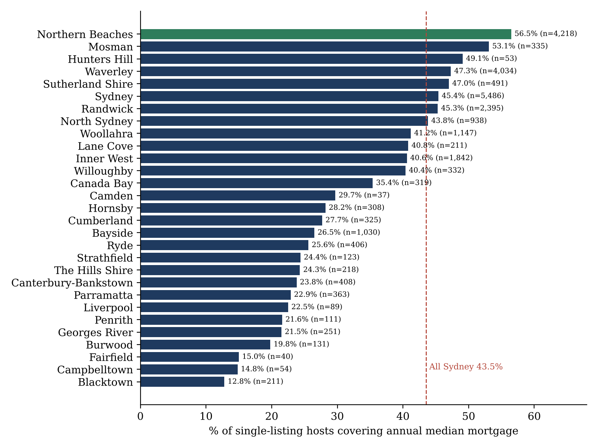
</p>

<p align="center"><em>Figure 7.9: Share of single-listing hosts covering the annualised median mortgage repayment</em></p>

<p align="center">
  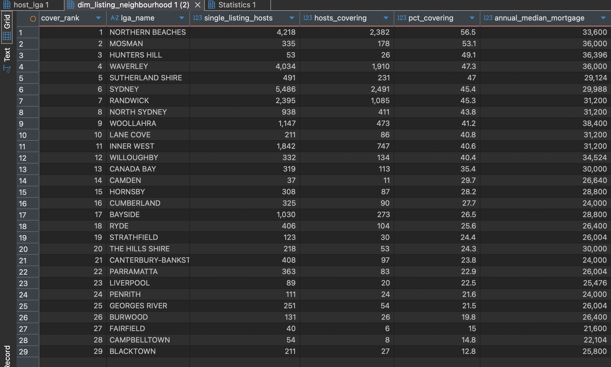
</p>

<p align="center"><em>Figure 7.10: Results table from DBeaver</em></p>

- 43.5% of single-listing hosts earn at least their LGA's annualised median mortgage repayment.
- **Northern Beaches leads at 56.5%**: median host revenue A$40,884 vs a A$33,600 annual mortgage.
- **Blacktown is lowest at 12.8%**: median revenue A$4,455 vs a A$25,800 annual mortgage.

## ⚠️ Issues Encountered and Resolutions

| Issue | Cause | Resolution |
|---|---|---|
| Composer environment could not be created | IAM Service Account Credentials API not enabled | Enabled the required APIs with `gcloud services enable` |
| dbt Cloud: "postgres adapter is not yet supported" | New projects default to the dbt Fusion engine | Switched environments to the v1.9 *Latest* (dbt Core) release track |
| dbt job ended with *Warning* | Deprecated `accepted_values` test syntax | Moved test arguments under `arguments:` |
| **June 2020 load hung for 27 minutes** | Cloud SQL connections stalled with no timeout; four tasks opened connections at once on a Small environment | Rewrote the DAG to fail fast and retry; the re-run finished in under a minute |
| Suburb file would not load | 25 empty trailing columns | DAG reads only the first two columns (`usecols=[0, 1]`) |
| Risk of duplicates on re-runs | Plain `COPY` appends every time | Delete-and-reload per `source_file` in one transaction |
| Census and LGA joins returned no rows | `LGA` code prefix; title vs upper case | Prefix stripped and `UPPER(TRIM())` applied in Silver |
| Rows in the wrong month | Scrape dates spill outside their file month | `month_year` derived from `source_file` |
| Snapshot failed on duplicate keys | A host appears once per listing each month | `DISTINCT ON (key)` ordered by latest month |
| First-month facts missing from datamart | First snapshot version started at the first run | Earliest version back-dated to `1900-01-01` |
| Property-type counts jumped in Jul–Aug 2020 | Airbnb renamed its taxonomy (40 → 90 types) | Kept as genuine SCD2 history; noted in question (c) |

## 🎯 Recommendations
- **Prioritise host acquisition** in Northern Beaches, Mosman and Waverley, which have the highest revenue and mortgage cover.
- **Promote entire apartments for 2–4 guests** in premium LGAs; treat large homes as a niche.
- **Offer property-management tools** to the 216 hosts with 11+ listings spread across several LGAs.
- **Position Airbnb as supplementary income** in Western Sydney rather than a way to pay off a mortgage.

## 📁 Repository Structure
```
.
├── macros/                          # Custom dbt macros
├── models/
│   ├── silver/                      # Typed and cleaned entities
│   └── gold/
│       ├── star/                    # Dimensions and fact_listings
│       └── datamart/                # dm_* KPI views
├── snapshots/                       # 5 SCD2 snapshots
├── Airbnb_ELT_README_with_images/
│   └── images/                      # Figures from the report
├── airbnb_bronze_loader.py          # Combined Airflow DAG (Parts 1 and 3)
├── part_1.sql                       # Bronze schema, raw tables, load checks
├── part_4.sql                       # Ad-hoc analysis queries (a)–(e)
├── dbt_project.yml                  # dbt project configuration
└── README.md
```

## ⚙️ How to Run

**Prerequisites:** a GCP project with Cloud Composer (Airflow 2), Cloud SQL for PostgreSQL, a dbt Cloud account on the v1.9 (dbt Core) release track, and DBeaver or any Postgres client.

1. **Clone the repository**
   ```bash
   git clone https://github.com/Dhrishita/Airbnb-Sydney-ELT-Pipeline.git
   cd Airbnb-Sydney-ELT-Pipeline
   ```
2. **Upload the data:** copy the 16 CSV files into the Composer bucket's `data/` folder (mounted on workers at `/home/airflow/gcs/data`).
3. **Create the Bronze layer:** run Sections 1–3 of `part_1.sql` in DBeaver against Cloud SQL.
4. **Add the Airflow connection:** create a Postgres connection named `postgres_conn` pointing to Cloud SQL.
5. **Deploy the DAG:** copy `airbnb_bronze_loader.py` into the Composer bucket's `dags/` folder.
6. **Load the first month:** trigger the DAG with `month_file = 05_2020.csv`, then run Section 4 of `part_1.sql` to check the row counts.
7. **Build the warehouse:** run the dbt Cloud job (`dbt build`).
8. **Load the remaining months:** for each month from `06_2020.csv` to `04_2021.csv`, in order, trigger the DAG, run Section 5 of `part_1.sql`, then run `dbt build`.
9. **Run the analysis:** execute `part_4.sql` against the Gold layer.

## 📝 Handover Notes
- **Schemas:** `bronze` (raw), `silver` (cleaned + snapshots), `gold` (star schema), `datamart` (views)
- **Run order:** one DAG run, then one `dbt build`, repeated in chronological order. **Never run `--full-refresh` on snapshots after all months are loaded**, or the monthly history is lost.
- **Idempotency:** reference loads skip when populated; re-running a month deletes and reloads its rows.
- **Control totals:** 412,122 Bronze listing rows; 12 distinct `source_file` values; fact rows must equal Bronze rows.
- **Known limitations:** a COVID-affected year; stays are inferred from availability, so host-blocked nights count as stays; the 2016 Census predates the listings by 4–5 years.

## Conclusion
The pipeline turns 16 inconsistent raw files into a tested, history-preserving warehouse that answers real business questions. Location drives revenue: harbour and coastal LGAs earn up to 7.2× more per active listing than Western Sydney. Income is a stronger signal than age, entire apartments for 2–4 guests are the most-booked format in premium areas, and whether hosting can cover a mortgage depends heavily on the LGA. The design choices (raw TEXT Bronze, dbt-owned logic, month-by-month SCD2 snapshots and point-in-time joins) keep these results accurate and reproducible.

## Contact
If you have any questions or suggestions, feel free to open an issue or contact: **Dhrishita Parve**: dhrishitap18@gmail.com

## References
- [Inside Airbnb: Sydney data](https://insideairbnb.com/get-the-data/)
- [ABS 2016 Census General Community Profile DataPack](https://www.abs.gov.au/AUSSTATS/abs@.nsf/Lookup/2069.0.30.001Main+Features12016)
- [dbt snapshots documentation](https://docs.getdbt.com/docs/build/snapshots)
- [Airflow Params documentation](https://airflow.apache.org/docs/apache-airflow/stable/core-concepts/params.html)
- [PostgreSQL COPY documentation](https://www.postgresql.org/docs/current/sql-copy.html)
- [Databricks: What is Medallion Architecture?](https://www.databricks.com/glossary/medallion-architecture)
